# SKATENEA — Sistema de Gestión de Rifas


**SKATENEA** es una plataforma multi-rifa con arquitectura cliente/servidor separada, pensada para operar rifas con trazabilidad, aprobaciones y una experiencia moderna.

- **Backend:** PHP 8.2 + PDO + POO + SOLID · API REST `/api/v1`
- **Frontend:** React 19 + TypeScript + Vite · glassmorphism · 12 temas × 3 modos
- **Base de datos:** MySQL 8+/MariaDB 10.6+ · SQLite para desarrollo
- **Seguridad:** JWT + refresh rotativo + API keys + RBAC + auditoría
- **Estado:** **V1.0.0 alfa endurecida** — lista para staging, no para producción con dinero real todavía

> **Repositorio:** https://github.com/genioloko19/skatenea.git  
> **Tag actual:** `v1.0.0`  
> **README principal:** este archivo. La documentación profunda vive en [`V1.0.0/docs/`](V1.0.0/docs/).

---

## Tabla de contenido

1. [Estructura del repositorio](#1-estructura-del-repositorio)
2. [Preparación](#2-preparación)
3. [Instalación rápida](#3-instalación-rápida)
4. [Instalación con MySQL](#4-instalación-con-mysql)
5. [Modo XAMPP/Apache opcional](#5-modo-xamppapache-opcional)
6. [Acceso y credenciales](#6-acceso-y-credenciales)
7. [Pantallazos](#7-pantallazos)
8. [Manual de usuario resumido](#8-manual-de-usuario-resumido)
9. [Recomendaciones](#9-recomendaciones)
10. [FAQs](#10-faqs)
11. [Posibles problemas y soluciones](#11-posibles-problemas-y-soluciones)
12. [Pruebas y calidad](#12-pruebas-y-calidad)
13. [Documentación](#13-documentación)
14. [Estado y pendientes](#14-estado-y-pendientes)

---

## 1. Estructura del repositorio

```text
SKATENEA/
├── README.md                  ← este documento
├── .gitignore
├── V1.0.0/
│   ├── servidor/              API PHP, dominio, infraestructura y pruebas
│   ├── cliente/               SPA React/TypeScript, temas y QA
│   ├── bd/                    Esquema, migraciones y seeds
│   └── docs/                  Plan, ADR, OpenAPI, manuales, QA y capturas
├── V0.0.1/                    (local, no versionado) versión alfa auditada
└── INFORMES/                  (local, no versionado) auditoría de seguridad
```

> En el repositorio de GitHub solo se versiona `V1.0.0/` y este README.  
> `V0.0.1/` e `INFORMES/` contienen secretos/PII de ejemplo y están excluidos por `.gitignore`.

---

## 2. Preparación

### 2.1 Requisitos mínimos

| Herramienta | Versión recomendada | Verificación |
|---|---|---|
| Windows | 10/11 | — |
| XAMPP | PHP 8.2+ | `php -v` |
| Composer | 2.x | `composer --version` |
| Node.js | 20+ (probado con 24) | `node -v` |
| npm | 10+ | `npm -v` |
| Navegador | Chrome, Edge o Firefox actualizado | — |

Extensiones PHP necesarias: `pdo`, `pdo_sqlite` o `pdo_mysql`, `mbstring`, `openssl`, `curl`, `fileinfo`, `json`.

### 2.2 Puertos

| Servicio | Puerto | Uso |
|---|---:|---|
| API PHP | `8000` | Backend en desarrollo |
| Vite | `5173` | Cliente en desarrollo |
| Apache | `80/443` | Opcional si usas XAMPP/Apache |
| MySQL | `3306` | Opcional si usas MySQL |

> Si un puerto está ocupado, cambia el puerto y ajusta el proxy o `VITE_API_URL`.

### 2.3 Checklist de preparación

- [ ] XAMPP instalado en `C:\xampp`.
- [ ] PHP disponible en la terminal.
- [ ] Composer instalado.
- [ ] Node.js y npm instalados.
- [ ] Puerto `8000` y `5173` libres.
- [ ] Repositorio clonado o carpeta del proyecto disponible.
- [ ] `.env` creado a partir de `.env.example`.
- [ ] `JWT_SECRET` generado.
- [ ] Base de datos migrada y seed ejecutado.
- [ ] Navegador apuntando a `http://localhost:5173`.

---

## 3. Instalación rápida

La forma recomendada para desarrollo es **dos terminales**: una para la API y otra para el cliente.

### 3.1 Terminal 1 — Backend

```powershell
cd C:\xampp\htdocs\SKATENEA\V1.0.0\servidor

composer install

# Solo si no existe .env
if (-not (Test-Path .env)) { Copy-Item .env.example .env }

# Genera y guarda un JWT_SECRET seguro
$secret = php -r "echo bin2hex(random_bytes(48));"
(Get-Content .env) -replace '^JWT_SECRET=.*', "JWT_SECRET=$secret" | Set-Content .env

# Primera vez o si quieres reiniciar la base local
php bin/migrate.php --fresh
php bin/seed.php

# Inicia la API
php -S 127.0.0.1:8000 -t public public/index.php
```

Verifica:

```text
http://localhost:8000/api/v1/health
```

Respuesta esperada:

```json
{"data":{"status":"ok","version":"1.0.0","environment":"local","database":"ok"}}
```

### 3.2 Terminal 2 — Cliente

```powershell
cd C:\xampp\htdocs\SKATENEA\V1.0.0\cliente

npm install
npm run dev
```

Debe mostrar:

```text
Local: http://localhost:5173/
```

### 3.3 Abre el navegador

```text
http://localhost:5173
```

> **Importante:** no abras `http://localhost/SKATENEA/V1.0.0/cliente/`. Esa carpeta contiene React/TypeScript sin compilar. Vite es quien la sirve y compila.

### 3.4 Workers opcionales

Para correo, webhooks e impresión, en terminales adicionales:

```powershell
cd C:\xampp\htdocs\SKATENEA\V1.0.0\servidor
php bin/mail-worker.php
php bin/webhook-worker.php
php bin/print-worker.php
```

No son necesarios para iniciar sesión ni navegar por la interfaz.

---

## 4. Instalación con MySQL

Por defecto `V1.0.0` usa **SQLite**, por lo que MySQL no es obligatorio. Si quieres usar MySQL/MariaDB:

1. Abre XAMPP Control Panel y pulsa **Start** en **MySQL**.
2. Crea la base y el usuario:

```powershell
C:\xampp\mysql\bin\mysql.exe -u root
```

```sql
CREATE DATABASE skatenea CHARACTER SET utf8mb4 COLLATE utf8mb4_unicode_ci;
CREATE USER 'skatenea_app'@'%' IDENTIFIED BY 'CAMBIA_ESTA_CLAVE';
GRANT SELECT, INSERT, UPDATE, DELETE ON skatenea.* TO 'skatenea_app'@'%';
FLUSH PRIVILEGES;
EXIT;
```

3. Edita `V1.0.0\servidor\.env`:

```env
DB_DRIVER=mysql
DB_HOST=127.0.0.1
DB_PORT=3306
DB_NAME=skatenea
DB_USER=skatenea_app
DB_PASS=CAMBIA_ESTA_CLAVE
DB_SSL_CA=
```

4. Ejecuta migraciones y seeds:

```powershell
cd C:\xampp\htdocs\SKATENEA\V1.0.0\servidor
php bin/migrate.php --fresh
php bin/seed.php
```

> En producción, usa un usuario con privilegios mínimos y TLS. Ver [`V1.0.0/bd/README.md`](V1.0.0/bd/README.md).

---

## 5. Modo XAMPP/Apache opcional

Si quieres servir todo con Apache en lugar de Vite:

1. Compila el cliente:

```powershell
cd C:\xampp\htdocs\SKATENEA\V1.0.0\cliente
$env:VITE_API_URL = 'http://api.skatenea.local/api/v1'
npm run build
```

2. Configura dos VirtualHost en `C:\xampp\apache\conf\extra\httpd-vhosts.conf`:

```apache
<VirtualHost *:80>
    ServerName skatenea.local
    DocumentRoot "C:/xampp/htdocs/SKATENEA/V1.0.0/cliente/dist"
    <Directory "C:/xampp/htdocs/SKATENEA/V1.0.0/cliente/dist">
        Require all granted
        FallbackResource /index.html
    </Directory>
</VirtualHost>

<VirtualHost *:80>
    ServerName api.skatenea.local
    DocumentRoot "C:/xampp/htdocs/SKATENEA/V1.0.0/servidor/public"
    <Directory "C:/xampp/htdocs/SKATENEA/V1.0.0/servidor/public">
        Require all granted
        FallbackResource /index.php
    </Directory>
</VirtualHost>
```

3. Añade a `C:\Windows\System32\drivers\etc\hosts`:

```text
127.0.0.1 skatenea.local
127.0.0.1 api.skatenea.local
```

4. En `servidor\.env`:

```env
APP_URL=http://api.skatenea.local
PUBLIC_WEB_URL=http://skatenea.local
CORS_ALLOWED_ORIGINS=http://skatenea.local
```

5. Reinicia Apache y abre:

```text
http://skatenea.local
```

> Para producción real se recomienda Nginx/PHP-FPM, HTTPS y HSTS. Ver [`V1.0.0/docs/deploy/`](V1.0.0/docs/deploy/).

---

## 6. Acceso y credenciales

### 6.1 Credenciales de desarrollo

| Rol | Correo | Contraseña |
|---|---|---|
| Super administrador | `admin@skatenea.local` | `Admin#2026!` |
| Líder | `lider@skatenea.local` | `Lider#2026!` |
| Vendedor | `vendedor@skatenea.local` | `Vendedor#2026!` |
| Comprador | `comprador@skatenea.local` | `Comprador#2026!` |

> Solo para desarrollo. Cámbialas y elimina los seeds antes de cualquier despliegue.

### 6.2 Flujo básico

1. Entra como **super administrador**.
2. Revisa el dashboard y el panel de control.
3. Entra como **líder**, crea una rifa y envíala a aprobación.
4. Vuelve como **super administrador** y apruébala en **Aprobaciones**.
5. Como **líder**, activa la rifa, genera boletas y asigna vendedores.
6. Como **vendedor**, separa y paga una boleta.
7. Como **comprador**, consulta tus boletas y verifica el QR.

---

## 7. Pantallazos

### 7.1 Pantallas principales

| Landing pública | Login |
|---|---|
| 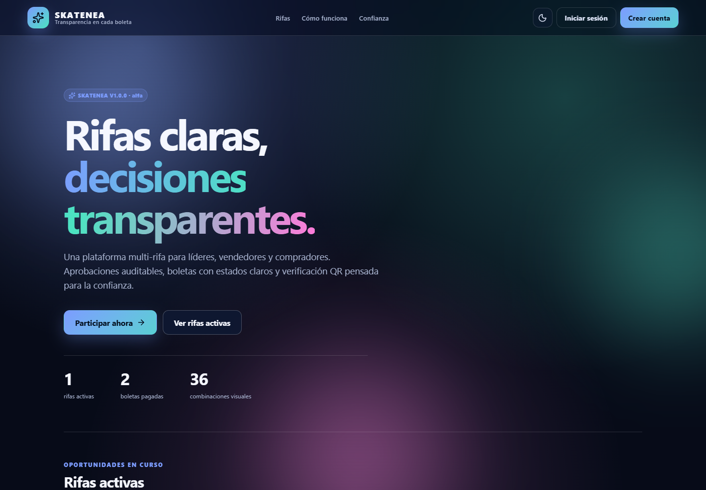 | 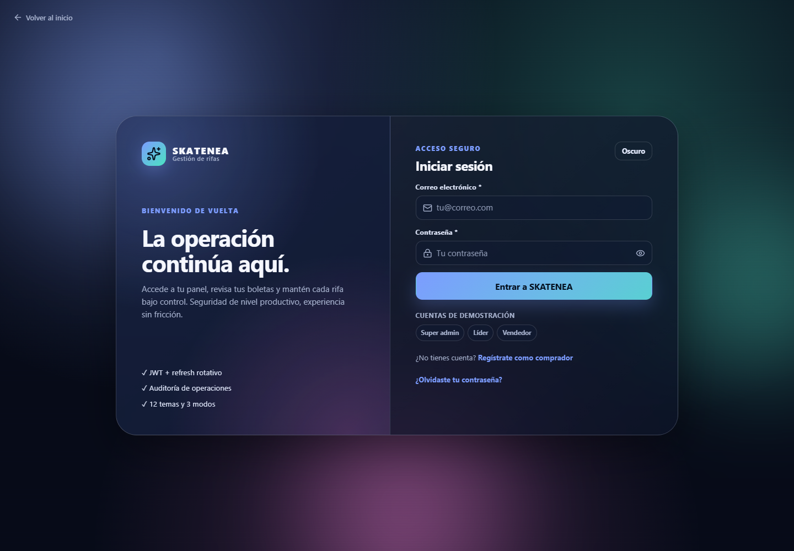 |

| Dashboard | Panel de control |
|---|---|
| 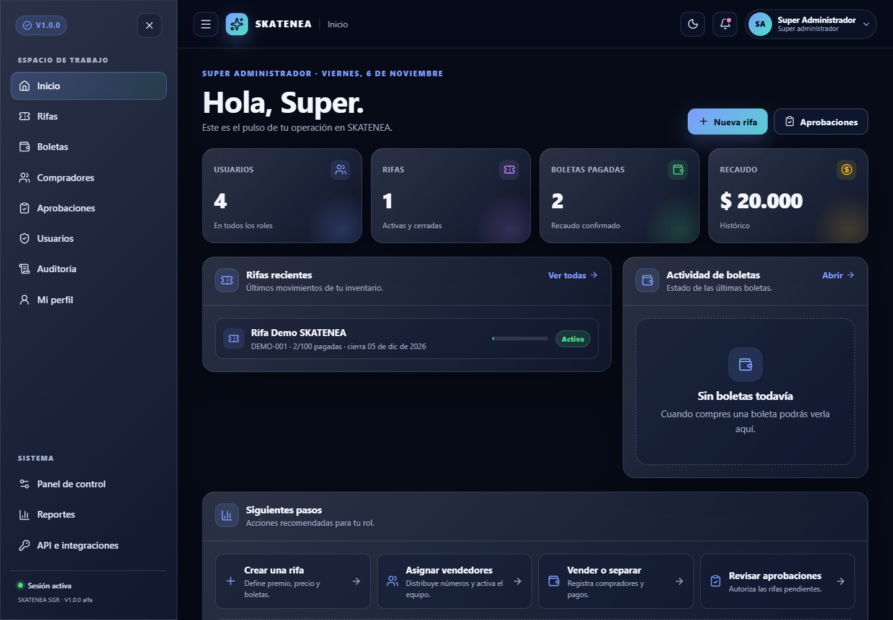 | 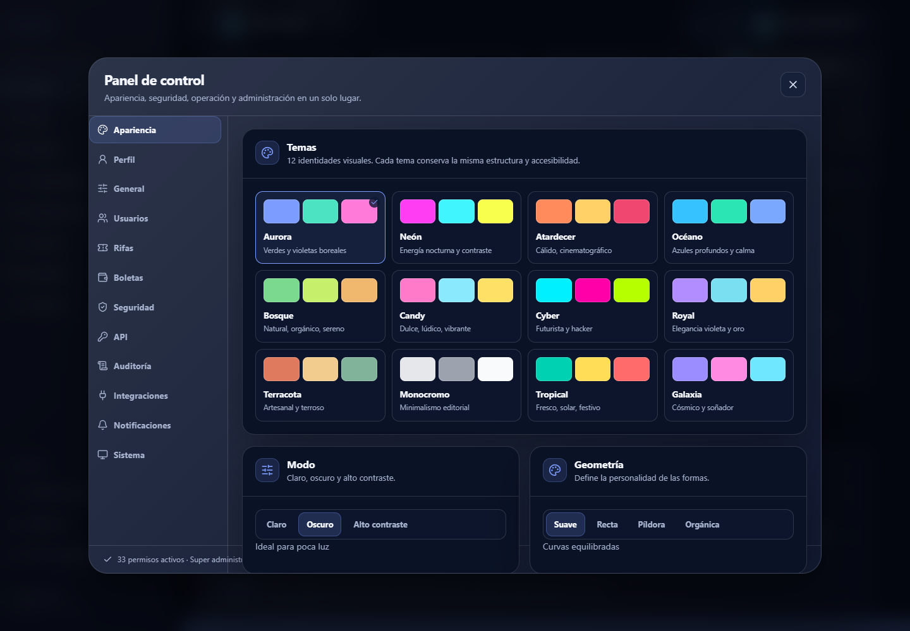 |

| Rifas | Detalle de rifa |
|---|---|
| 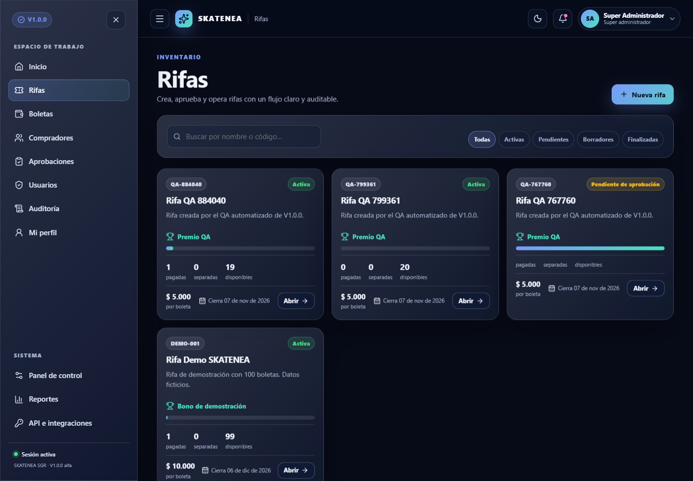 | 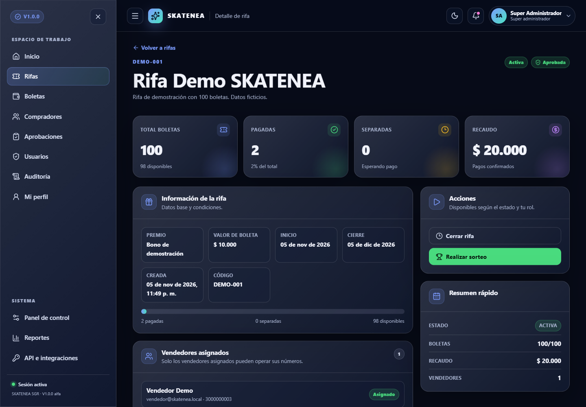 |

| Boletas | Usuarios |
|---|---|
| 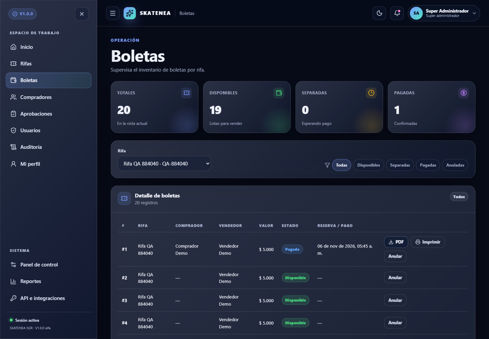 | 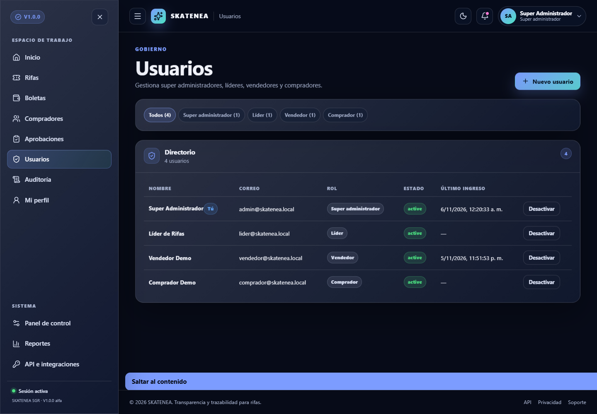 |

### 7.2 Evidencia E2E

| Aprobación | Rifa gestionada |
|---|---|
| 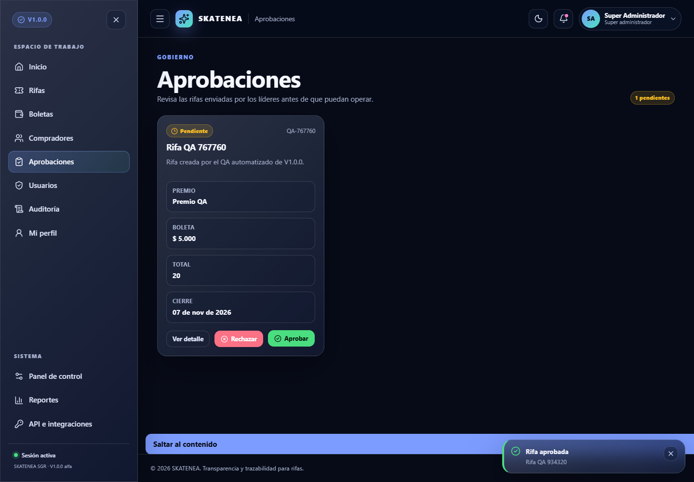 | 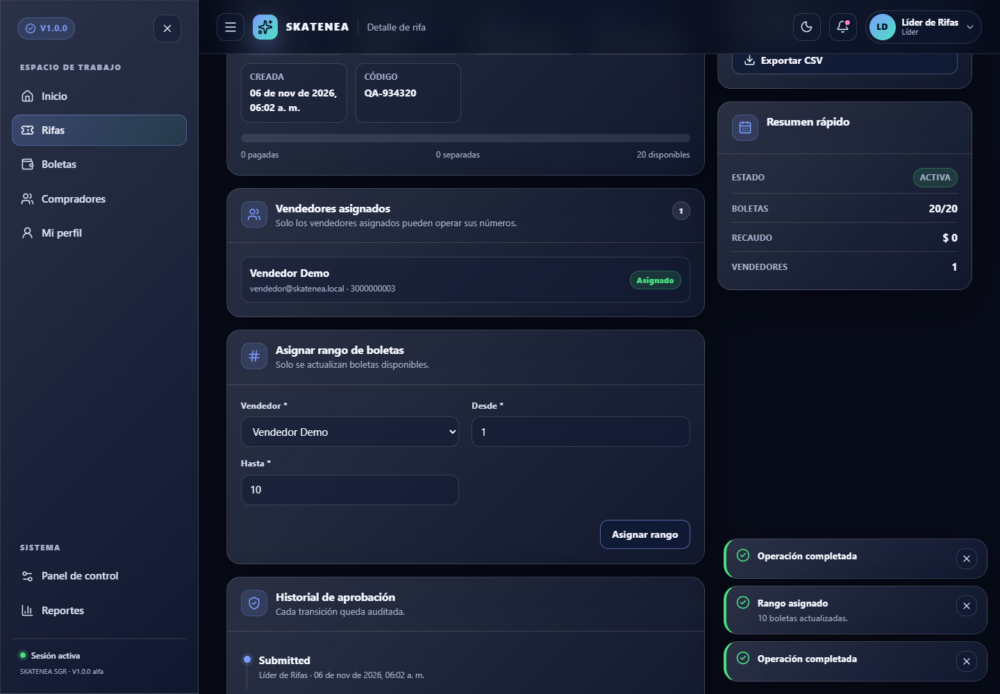 |

| Boleta pagada | Verificación QR |
|---|---|
| 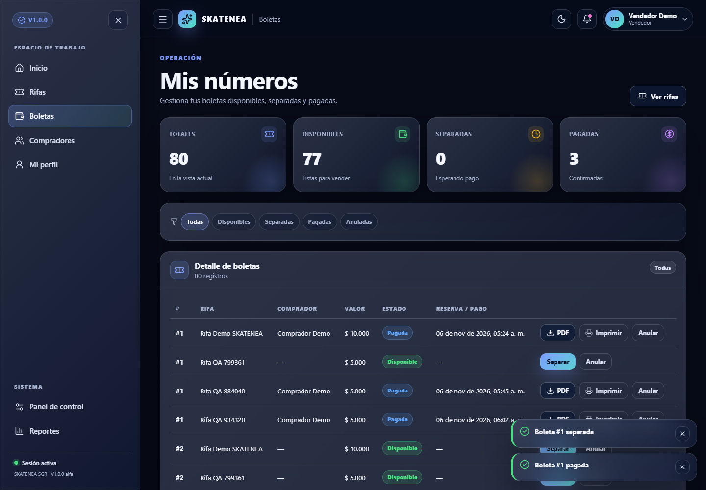 | 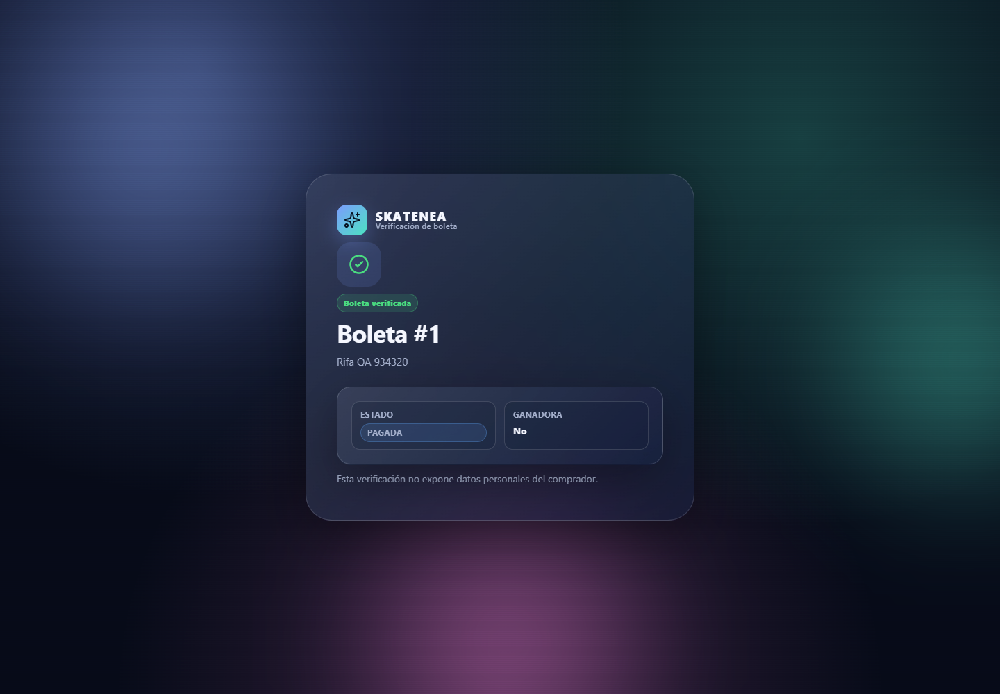 |

### 7.3 Los 12 temas

| Tema | Claro | Oscuro | Alto contraste |
|---|---|---|---|
| Aurora | [ver](V1.0.0/docs/assets/screenshots/theme-aurora-light.png) | [ver](V1.0.0/docs/assets/screenshots/theme-aurora-dark.png) | [ver](V1.0.0/docs/assets/screenshots/theme-aurora-contrast.png) |
| Neón | [ver](V1.0.0/docs/assets/screenshots/theme-neon-light.png) | [ver](V1.0.0/docs/assets/screenshots/theme-neon-dark.png) | [ver](V1.0.0/docs/assets/screenshots/theme-neon-contrast.png) |
| Atardecer | [ver](V1.0.0/docs/assets/screenshots/theme-sunset-light.png) | [ver](V1.0.0/docs/assets/screenshots/theme-sunset-dark.png) | [ver](V1.0.0/docs/assets/screenshots/theme-sunset-contrast.png) |
| Océano | [ver](V1.0.0/docs/assets/screenshots/theme-ocean-light.png) | [ver](V1.0.0/docs/assets/screenshots/theme-ocean-dark.png) | [ver](V1.0.0/docs/assets/screenshots/theme-ocean-contrast.png) |
| Bosque | [ver](V1.0.0/docs/assets/screenshots/theme-forest-light.png) | [ver](V1.0.0/docs/assets/screenshots/theme-forest-dark.png) | [ver](V1.0.0/docs/assets/screenshots/theme-forest-contrast.png) |
| Candy | [ver](V1.0.0/docs/assets/screenshots/theme-candy-light.png) | [ver](V1.0.0/docs/assets/screenshots/theme-candy-dark.png) | [ver](V1.0.0/docs/assets/screenshots/theme-candy-contrast.png) |
| Cyber | [ver](V1.0.0/docs/assets/screenshots/theme-cyber-light.png) | [ver](V1.0.0/docs/assets/screenshots/theme-cyber-dark.png) | [ver](V1.0.0/docs/assets/screenshots/theme-cyber-contrast.png) |
| Royal | [ver](V1.0.0/docs/assets/screenshots/theme-royal-light.png) | [ver](V1.0.0/docs/assets/screenshots/theme-royal-dark.png) | [ver](V1.0.0/docs/assets/screenshots/theme-royal-contrast.png) |
| Terracota | [ver](V1.0.0/docs/assets/screenshots/theme-terracotta-light.png) | [ver](V1.0.0/docs/assets/screenshots/theme-terracotta-dark.png) | [ver](V1.0.0/docs/assets/screenshots/theme-terracotta-contrast.png) |
| Monocromo | [ver](V1.0.0/docs/assets/screenshots/theme-mono-light.png) | [ver](V1.0.0/docs/assets/screenshots/theme-mono-dark.png) | [ver](V1.0.0/docs/assets/screenshots/theme-mono-contrast.png) |
| Tropical | [ver](V1.0.0/docs/assets/screenshots/theme-tropical-light.png) | [ver](V1.0.0/docs/assets/screenshots/theme-tropical-dark.png) | [ver](V1.0.0/docs/assets/screenshots/theme-tropical-contrast.png) |
| Galaxia | [ver](V1.0.0/docs/assets/screenshots/theme-galaxy-light.png) | [ver](V1.0.0/docs/assets/screenshots/theme-galaxy-dark.png) | [ver](V1.0.0/docs/assets/screenshots/theme-galaxy-contrast.png) |

Galería completa: [`V1.0.0/docs/assets/screenshots/README.md`](V1.0.0/docs/assets/screenshots/README.md).

---

## 8. Manual de usuario resumido

### 8.1 Roles

| Rol | Alcance |
|---|---|
| **Super administrador** | Todo: aprobar/rechazar rifas, usuarios, API keys, auditoría y configuración |
| **Líder** | Crear y editar sus rifas, asignar vendedores y boletas |
| **Vendedor** | Operar sus boletas: disponible, separada, pagada |
| **Comprador** | Ver rifas activas, sus boletas y verificar QR |

### 8.2 Ciclo de una rifa

```text
Borrador → Pendiente de aprobación → Aprobada → Activa → Cerrada → Finalizada
                                    ↘ Rechazada
```

1. El líder crea la rifa.
2. La envía a aprobación.
3. El super administrador la aprueba o rechaza.
4. El líder la activa, genera boletas y asigna vendedores.
5. El vendedor separa y paga boletas.
6. El super administrador realiza el sorteo.
7. El comprador verifica su boleta por QR.

### 8.3 Estados de boleta

| Estado | Significado |
|---|---|
| **Disponible** | Libre para vender |
| **Separada** | Apartada, esperando pago |
| **Pagada** | Pago confirmado |
| **Anulada** | Fuera de circulación |
| **Ganadora** | Seleccionada en el sorteo |

### 8.4 Acciones clave

- **Separar:** datos del comprador + horas de reserva.
- **Pagar:** método de pago; el monto se toma del valor de la boleta.
- **PDF:** comprobante con QR.
- **Imprimir:** encola la boleta en la impresora térmica.
- **Exportar CSV:** inventario de la rifa.
- **Panel de control:** tema, modo, perfil, seguridad, API, auditoría y notificaciones.

Manual completo: [`V1.0.0/docs/manual-usuario/MANUAL_USUARIO.md`](V1.0.0/docs/manual-usuario/MANUAL_USUARIO.md).

---

## 9. Recomendaciones

### 9.1 Desarrollo

- Usa `php bin/migrate.php --fresh` solo en local; **borra los datos**.
- No uses las credenciales de demostración fuera de desarrollo.
- No abras `cliente/` directamente; usa Vite.
- Mantén `.env` fuera de Git y de cualquier carpeta pública.
- Revisa `V1.0.0/docs/qa/QA_RESULTS.md` antes de cambiar flujos críticos.

### 9.2 Seguridad

- Cambia `JWT_SECRET` antes de publicar.
- Usa HTTPS, `COOKIE_SECURE=true` y `COOKIE_SAMESITE=Strict` en producción.
- Rota credenciales de BD y correo.
- Restringe MySQL por firewall y usa un usuario de mínimo privilegio.
- Bloquea `INFORMES/`, `V0.0.1/`, `vendor/` y `.env` desde el servidor web.
- Ejecuta `composer audit` y `npm audit` en CI.
- No uses `WEBHOOK_ALLOW_PRIVATE=true` en producción.
- Revisa la auditoría y las notificaciones periódicamente.

### 9.3 Operación

- Ejecuta los workers con systemd/supervisor.
- Programa `php bin/maintenance.php` a diario.
- Configura backups cifrados y prueba la restauración.
- Monitorea 5xx, 401/403/429, colas y webhooks fallidos.
- Mantén ventanas de mantenimiento documentadas.

### 9.4 Cumplimiento

- Revisa la [matriz de cumplimiento](V1.0.0/docs/compliance/MATRIZ_CUMPLIMIENTO.md).
- Completa la revisión legal de Ley 1581 y Ley 643.
- Verifica la autorización de Coljuegos y la edad de los participantes.
- No uses el software como sustituto de la autorización estatal.

---

## 10. FAQs

**¿Necesito MySQL para iniciar?**  
No. La configuración por defecto usa SQLite. MySQL es opcional.

**¿Necesito iniciar Apache en XAMPP?**  
No para el modo recomendado con `php -S` y Vite. Apache solo es necesario si usas el modo Apache opcional.

**¿Por qué no abre `http://localhost/SKATENEA/V1.0.0/cliente/`?**  
Porque es código fuente React/TypeScript. Debes usar `npm run dev` y abrir `http://localhost:5173`.

**¿Dónde está la base de datos SQLite?**  
En `V1.0.0/bd/skatenea.sqlite` (por defecto). Está ignorada por Git.

**¿Cómo reinicio los datos de prueba?**  
`php bin/migrate.php --fresh` y luego `php bin/seed.php`. Esto borra la base local.

**¿Cómo cambio el tema?**  
Menú de usuario → **Panel de control** → **Apariencia**. También puedes usar el botón de sol/luna/contraste del header.

**¿Cómo recupero mi contraseña?**  
Login → **¿Olvidaste tu contraseña?** → correo registrado. En desarrollo el correo se escribe en `servidor/storage/logs/mail.log`.

**¿Por qué no se envía el correo?**  
En desarrollo `MAIL_DRIVER=log`. Revisa `storage/logs/mail.log`. Para envío real configura SMTP y `MAIL_DRIVER=smtp`.

**¿Por qué no imprime?**  
La impresión es una cola. Debes ejecutar `php bin/print-worker.php` y configurar `PRINT_DRIVER` (`file`, `network`, `windows` o `null`).

**¿Cómo verifico una boleta?**  
Escanea el QR del PDF o abre `PUBLIC_WEB_URL/verify/<token>`.

**¿Puedo cambiar el monto del pago?**  
No. El monto se toma del valor de la boleta; no se acepta un monto arbitrario del navegador.

**¿Dónde veo los errores?**  
Comparte el `X-Request-Id` de la respuesta y revisa `servidor/storage/logs/app.log`.

---

## 11. Posibles problemas y soluciones

| Problema | Causa probable | Solución |
|---|---|---|
| `php` no se reconoce | PHP fuera del PATH | Usa `C:\xampp\php\php.exe` o agrega `C:\xampp\php` al PATH |
| `composer` no se reconoce | Composer no instalado o fuera del PATH | Instala Composer y reinicia la terminal |
| `npm` no se reconoce | Node.js no instalado | Instala Node.js LTS y reinicia la terminal |
| `No se pudo conectar` en el login | API apagada | Verifica `http://localhost:8000/api/v1/health` |
| `ERR_CONNECTION_REFUSED` en `5173` | Vite apagado | Ejecuta `npm run dev` |
| `Port 8000 already in use` | Otro proceso usa el puerto | Cambia a `8080` y ajusta el proxy de Vite |
| `Port 5173 already in use` | Otro Vite/proceso | Usa el puerto que Vite proponga |
| `JWT_SECRET debe tener al menos 32 caracteres` | `.env` incompleto | Genera un secreto de 48 bytes y guárdalo en `.env` |
| `No se pudo conectar a la base de datos` | `.env` o driver incorrecto | Revisa `DB_DRIVER`, ruta SQLite o credenciales MySQL |
| `no such table` / tablas faltantes | Migración no ejecutada | `php bin/migrate.php --fresh` |
| `SQLSTATE[HY000]` en SQLite | Archivo bloqueado o corrupto | Cierra procesos, revisa permisos o recrea la base local |
| `Access denied for user` en MySQL | Usuario/clave incorrectos | Revisa `DB_USER` y `DB_PASS`; crea el usuario |
| `429 Too Many Requests` | Rate limit | Espera o sube `RATE_LIMIT_MAX` en desarrollo |
| `401` después de recargar | Cookie/CSRF o API caída | Revisa cookies, CORS y que la API siga viva |
| `CORS` bloqueado | Origen no permitido | Agrega el origen exacto en `CORS_ALLOWED_ORIGINS` |
| PDF no se genera | Falta `mpdf/qrcode` | `composer require mpdf/qrcode` y reinstala |
| Error al imprimir | Worker apagado o driver mal configurado | Ejecuta `php bin/print-worker.php` y revisa `PRINT_DRIVER` |
| Webhook con `422` | URL privada/reservada bloqueada | En desarrollo usa `WEBHOOK_ALLOW_PRIVATE=true` |
| Webhook no llega | Worker apagado o destino caído | Ejecuta `php bin/webhook-worker.php` y revisa entregas |
| Correo no llega | `MAIL_DRIVER=log` | Revisa `storage/logs/mail.log` o configura SMTP |
| Página en blanco | Error de JS o build viejo | Abre consola, borra caché y reinicia Vite |
| Estilos sin tema | `localStorage`/preferencias | Restablece apariencia desde el panel de control |
| `npm install` con warnings de engine | Node ligeramente anterior al requerido por una dev-dependency | Usa Node LTS actualizado; los tests pasan igualmente |
| `--fresh` borró datos | Reset intencional | Restaura backup; no usar `--fresh` en producción |

### 11.1 Si nada funciona

Ejecuta esta secuencia mínima:

```powershell
cd C:\xampp\htdocs\SKATENEA\V1.0.0\servidor
php -v
composer install
if (-not (Test-Path .env)) { Copy-Item .env.example .env }
php bin/migrate.php --fresh
php bin/seed.php
php -S 127.0.0.1:8000 -t public public/index.php
```

En otra terminal:

```powershell
cd C:\xampp\htdocs\SKATENEA\V1.0.0\cliente
node -v
npm install
npm run dev
```

Luego abre `http://localhost:5173`.

---

## 12. Pruebas y calidad

```powershell
cd C:\xampp\htdocs\SKATENEA\V1.0.0\servidor
composer quality

cd C:\xampp\htdocs\SKATENEA\V1.0.0\cliente
npm run lint
npm run test
npm run build
npm run qa:smoke
npm run qa:e2e
npm run qa:axe
npm run qa:perf
```

Resultados actuales:

| Prueba | Resultado |
|---|---|
| PHPUnit | 20/20 |
| Vitest | 8/8 |
| PHPStan nivel 6 | 0 errores |
| PHPCS PSR-12 | 0 errores |
| Smoke UI | 47/47 |
| E2E por roles | 23/23 |
| Accesibilidad axe | 0 graves/críticos |
| Performance base | 15–16 req/s, 0 errores (PHP built-in) |

Ver [`V1.0.0/docs/qa/QA_RESULTS.md`](V1.0.0/docs/qa/QA_RESULTS.md).

---

## 13. Documentación

| Documento | Enlace |
|---|---|
| Plan maestro | [`V1.0.0/docs/plan/PLAN_MAESTRO.md`](V1.0.0/docs/plan/PLAN_MAESTRO.md) |
| ADRs | [`V1.0.0/docs/adr/`](V1.0.0/docs/adr/) |
| OpenAPI 3.1 | [`V1.0.0/docs/api/openapi.yaml`](V1.0.0/docs/api/openapi.yaml) |
| Manual técnico | [`V1.0.0/docs/manual-tecnico/MANUAL_TECNICO.md`](V1.0.0/docs/manual-tecnico/MANUAL_TECNICO.md) |
| Integraciones | [`V1.0.0/docs/manual-tecnico/INTEGRACIONES.md`](V1.0.0/docs/manual-tecnico/INTEGRACIONES.md) |
| Manual de usuario | [`V1.0.0/docs/manual-usuario/MANUAL_USUARIO.md`](V1.0.0/docs/manual-usuario/MANUAL_USUARIO.md) |
| QA | [`V1.0.0/docs/qa/QA_RESULTS.md`](V1.0.0/docs/qa/QA_RESULTS.md) |
| E2E | [`V1.0.0/docs/qa/E2E_REPORT.md`](V1.0.0/docs/qa/E2E_REPORT.md) |
| Accesibilidad | [`V1.0.0/docs/qa/ACCESSIBILITY_REPORT.md`](V1.0.0/docs/qa/ACCESSIBILITY_REPORT.md) |
| Performance | [`V1.0.0/docs/qa/PERFORMANCE_REPORT.md`](V1.0.0/docs/qa/PERFORMANCE_REPORT.md) |
| Matriz de cumplimiento | [`V1.0.0/docs/compliance/MATRIZ_CUMPLIMIENTO.md`](V1.0.0/docs/compliance/MATRIZ_CUMPLIMIENTO.md) |
| Modelo de amenazas | [`V1.0.0/docs/security/MODELO_AMENAZAS.md`](V1.0.0/docs/security/MODELO_AMENAZAS.md) |
| Despliegue | [`V1.0.0/docs/deploy/`](V1.0.0/docs/deploy/) |
| Base de datos | [`V1.0.0/bd/README.md`](V1.0.0/bd/README.md) |
| Backend | [`V1.0.0/servidor/README.md`](V1.0.0/servidor/README.md) |
| Frontend | [`V1.0.0/cliente/README.md`](V1.0.0/cliente/README.md) |

---

## 14. Estado y pendientes

| Fase | Estado |
|---|---|
| 0 — Gobierno y estructura | ✅ |
| 1 — Base de datos y dominio | ✅ |
| 2 — Núcleo API | ✅ |
| 3 — Identidad, acceso y auditoría | ✅ |
| 4 — Rifas, boletas y pagos | ✅ |
| 5 — Shell de cliente y diseño | ✅ |
| 6 — Portales por rol | ✅ |
| 7 — Integraciones | ✅ |
| 8 — Endurecimiento y cumplimiento | 🟡 técnico implementado; faltan pentest, MFA y revisión legal |
| 9 — QA y release | ✅ QA smoke/E2E/axe/perf + tag `v1.0.0`; 🟡 release page/artefactos |

### Pendientes antes de producción

- [ ] Pentest externo ASVS L2.
- [ ] MFA para super administradores.
- [ ] Revisión legal Ley 1581 / Ley 643 y autorización de Coljuegos.
- [ ] Verificación de edad/identidad.
- [ ] Pruebas Firefox/Safari/Edge y certificación WCAG externa.
- [ ] Restauración de backups probada.
- [ ] Release page con artefactos descargables.

---

## Licencia

Propietaria. Todos los derechos reservados. El uso, copia o distribución requiere autorización del titular.

## Soporte

Antes de abrir un issue, revisa la sección [Posibles problemas y soluciones](#11-posibles-problemas-y-soluciones) y adjunta:

- Versión (`v1.0.0`).
- Comando ejecutado.
- Mensaje de error.
- `X-Request-Id` si es un error de API.
- Captura o log relevante, sin datos personales reales.
