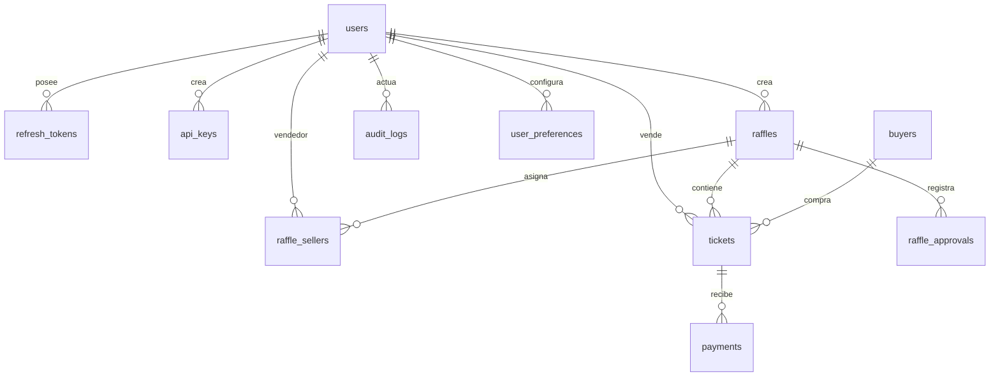

# Base de datos — SKATENEA V1

Esquema portable para MySQL 8+/MariaDB 10.6+ y SQLite 3.35+. No usa `ENUM` ni `JSON` para mantener compatibilidad; los estados se validan con `CHECK` y en la capa de aplicación.

## Tablas

| Tabla | Propósito |
|---|---|
| `users` | Usuarios y roles (`super_admin`, `leader`, `seller`, `buyer`) |
| `refresh_tokens` | Refresh tokens rotativos hasheados y revocación |
| `api_keys` | Claves de integración con scopes y expiración |
| `raffles` | Rifas multi-tenant con estado y aprobación |
| `raffle_sellers` | Asignación de vendedores a rifas |
| `buyers` | Compradores (con o sin cuenta) |
| `tickets` | Boletas por rifa, vendedor, comprador y estado |
| `payments` | Pagos confirmados o pendientes |
| `raffle_approvals` | Historial de envío, aprobación, rechazo y cancelación |
| `audit_logs` | Auditoría append-only |
| `settings` | Configuración clave-valor |
| `user_preferences` | Tema, modo, geometría, fondo y sidebar |
| `password_resets` | Tokens de recuperación de un solo uso |
| `notifications` | Notificaciones por usuario |

## Diagrama



## Flujo de estados

### Rifa

```
draft → pending_approval → approved → active → closed → finished
                         ↘ rejected
active/approved → cancelled
```

### Boleta

```
available → reserved → paid → winner
     ↘ cancelled ↙
```

## Migración

### SQLite (desarrollo)

```powershell
cd ..\servidor
php bin/migrate.php --fresh
php bin/seed.php
```

### MySQL / MariaDB

1. Crear la base y el usuario:

```sql
CREATE DATABASE skatenea CHARACTER SET utf8mb4 COLLATE utf8mb4_unicode_ci;
CREATE USER 'skatenea_app'@'%' IDENTIFIED BY 'CAMBIA_ESTA_CLAVE';
GRANT SELECT, INSERT, UPDATE, DELETE ON skatenea.* TO 'skatenea_app'@'%';
FLUSH PRIVILEGES;
```

2. Configurar `servidor/.env`:

```env
DB_DRIVER=mysql
DB_HOST=127.0.0.1
DB_PORT=3306
DB_NAME=skatenea
DB_USER=skatenea_app
DB_PASS=CAMBIA_ESTA_CLAVE
DB_SSL_CA=
```

3. Ejecutar:

```powershell
cd ..\servidor
php bin/migrate.php
php bin/seed.php
```

## Integridad

- IDs UUID v4 (`CHAR(36)`) para no exponer secuencias.
- `UNIQUE(raffle_id, number)` evita boletas duplicadas.
- `token` único por boleta para QR no predecible.
- FKs con `ON DELETE CASCADE/SET NULL` según corresponda.
- Dinero en `DECIMAL(12,2)`.
- Fechas en UTC (`DATETIME`).
- Transiciones de estado condicionales para evitar doble venta.

## Respaldos

- `mysqldump --single-transaction --routines --triggers`.
- Cifrado en reposo y fuera del webroot.
- Probar restauración trimestralmente.
- No versionar `.sqlite`, `.env` ni respaldos.
