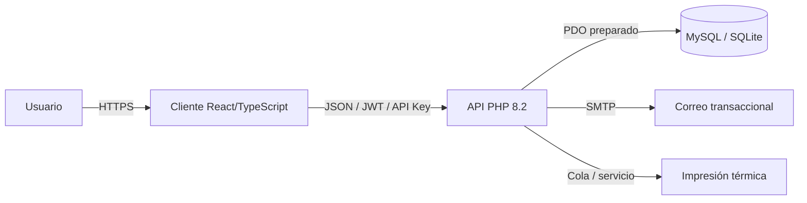
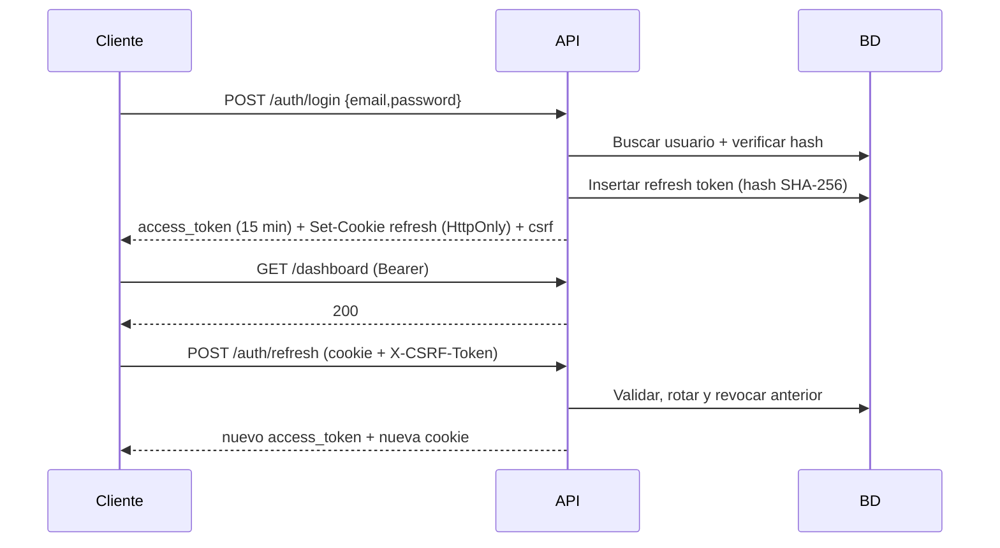

# Manual técnico — SKATENEA V1.0.0

**Audiencia:** desarrollo, DevOps, seguridad y soporte técnico.  
**Alcance:** arquitectura, dominio, API, base de datos, seguridad, despliegue y extensión.

---

## 1. Visión general

SKATENEA es un sistema multi-rifa con cliente y servidor desacoplados:



- El cliente nunca accede a la base de datos.
- El servidor expone una API versionada `/api/v1`.
- Los secretos viven en `.env`, nunca en el repositorio.
- La base de datos usa UUID y restricciones de integridad.

## 2. Capas del servidor

| Capa | Ruta | Responsabilidad |
|---|---|---|
| Core | `servidor/src/Core` | Config, PDO, HTTP, router, validación, rate limit, logs |
| Auth | `servidor/src/Auth` | JWT, refresh, API keys, RBAC, cookies, políticas |
| Domain | `servidor/src/Domain` | Entidades e interfaces; sin PDO ni HTTP |
| Application | `servidor/src/Application` | Casos de uso, reglas y transacciones |
| Infrastructure | `servidor/src/Infrastructure` | Repositorios PDO |
| HTTP | `servidor/src/Http` | Controllers y middleware |

Regla de dependencia: `Http → Application → Domain`; `Infrastructure` implementa interfaces del dominio y se inyecta desde `config/bootstrap.php`.

## 3. Dominio

### 3.1 Usuarios y roles

| Rol | Constante | Capacidades |
|---|---|---|
| Super administrador | `super_admin` | Todo el sistema, aprobaciones, usuarios, API keys, auditoría, configuración |
| Líder | `leader` | Crear/editar sus rifas, asignar vendedores, generar boletas |
| Vendedor | `seller` | Operar sus boletas (disponible, separada, pagada) |
| Comprador | `buyer` | Ver rifas activas y sus boletas |

Los permisos están en `servidor/src/Auth/Rbac.php`. La autorización por propietario se valida en los servicios (`assertCanManage`, `assertCanOperate`, `assertCanView`).

### 3.2 Rifa

Estados: `draft → pending_approval → approved → active → closed → finished`; rechazo `rejected`; cancelación `cancelled`.

- Solo el líder propietario o el super administrador pueden gestionarla.
- Solo el super administrador aprueba, rechaza, cancela o sortea.
- Solo una rifa `active` y dentro de fechas permite vender.

### 3.3 Boleta

Estados: `available`, `reserved`, `paid`, `cancelled`, `winner`.

- `available → reserved`: separación con comprador y vencimiento.
- `reserved → paid`: pago confirmado; el monto se toma del precio de la boleta, nunca del cliente.
- `paid → winner`: sorteo.
- Anulación: condicional; una boleta pagada solo la anula el super administrador.

La transición se implementa con actualización condicional (`WHERE id = ? AND status = ?`) y `rowCount`, lo que evita doble venta sin depender de `SELECT FOR UPDATE`.

## 4. Autenticación y sesión



- Access token: JWT HS256, claims `iss`, `aud`, `sub`, `role`, `jti`, `iat`, `nbf`, `exp`.
- Refresh: 64 bytes aleatorios; en BD solo el hash; rotación y detección de reutilización.
- El frontend mantiene el access token **en memoria**; nunca en `localStorage`.
- Cookies: `HttpOnly` para refresh, `SameSite=Lax` (dev) / `Strict` (prod), `Secure` en HTTPS.

## 5. API

- Base: `/api/v1`.
- Contrato: [`docs/api/openapi.yaml`](../api/openapi.yaml).
- Éxito: `{ "data": ... }`, con `meta` cuando aplica.
- Error:

```json
{
  "error": {
    "code": "validation_error",
    "message": "Revisa los datos enviados.",
    "details": { "email": ["Debe ser un correo válido."] }
  }
}
```

- Cada respuesta incluye `X-Request-Id`; los logs lo correlacionan.
- Códigos: `unauthorized`, `forbidden`, `not_found`, `conflict`, `validation_error`, `too_many_requests`, `internal_error`.

### 5.1 Endpoints principales

| Método | Ruta | Permiso |
|---|---|---|
| POST | `/auth/login` | Público |
| POST | `/auth/refresh` | Cookie + CSRF |
| POST | `/auth/logout` | Público (revoca cookie) |
| POST | `/auth/register` | Público (comprador) |
| GET | `/auth/me` | Autenticado |
| PATCH | `/auth/password` | `profile.update` |
| GET | `/dashboard` | `dashboard.read` |
| GET/POST | `/raffles` | `raffles.read` / `raffles.create` |
| PATCH | `/raffles/{id}` | `raffles.update` + propiedad |
| POST | `/raffles/{id}/submit` | `raffles.submit` + propiedad |
| POST | `/raffles/{id}/approve` | `raffles.approve` (super admin) |
| POST | `/raffles/{id}/reject` | `raffles.approve` (super admin) |
| POST | `/raffles/{id}/activate` | `raffles.activate` + propiedad |
| POST | `/raffles/{id}/close` | `raffles.close` + propiedad |
| POST | `/raffles/{id}/cancel` | `raffles.delete` (super admin) |
| POST | `/raffles/{id}/sellers` | `tickets.assign` |
| POST | `/raffles/{id}/tickets/generate` | `tickets.assign` |
| POST | `/raffles/{id}/tickets/assign` | `tickets.assign` |
| POST | `/raffles/{id}/draw` | `raffles.approve` (super admin) |
| GET | `/raffles/{id}/tickets` | `tickets.read` |
| GET | `/tickets/mine` | `tickets.read` |
| POST | `/tickets/{id}/reserve` | `tickets.reserve` + propietario |
| POST | `/tickets/{id}/pay` | `tickets.pay` + propietario |
| POST | `/tickets/{id}/cancel` | `tickets.cancel` + propietario |
| GET/POST | `/buyers` | `buyers.read` / `buyers.create` |
| GET | `/sellers` | `tickets.assign` |
| GET/POST | `/users` | `users.read` / `users.create` (super admin) |
| GET/PATCH | `/preferences` | `profile.update` |
| GET/POST | `/api-keys` | `api_keys.read` / `api_keys.create` |
| DELETE | `/api-keys/{id}` | `api_keys.revoke` |
| GET | `/audit` | `audit.read` |
| GET/PATCH | `/settings` | `settings.read` / `settings.update` |
| GET | `/integrations/raffles` | API key `raffles.read` |

## 6. Base de datos

Ver [`bd/README.md`](../../bd/README.md). Puntos clave:

- IDs `CHAR(36)` (UUID v4).
- `UNIQUE(raffle_id, number)` y `UNIQUE(token)`.
- Dinero `DECIMAL(12,2)`.
- Fechas UTC.
- FKs y `CHECK` para estados.
- `audit_logs` append-only desde la aplicación.
- `user_preferences` para theming.

### 6.1 Migración y seeds

```powershell
cd servidor
php bin/migrate.php --fresh
php bin/seed.php
```

`--fresh` elimina y recrea las tablas. **Nunca usarlo en producción.**

## 7. Cliente

- React 19 + TypeScript + Vite.
- `src/api/client.ts`: fetch tipado, refresh automático, deduplicación de refresh, CSRF.
- `src/auth/AuthContext.tsx`: bootstrap único, sesión, permisos, preferencias.
- `src/theme/ThemeProvider.tsx`: aplica `data-theme`, `data-mode`, `data-geometry`, `data-background`, `data-motion`.
- `src/components/layout`: header, sidebar, footer, background, skip link.
- `src/components/controlpanel`: modal de 12 pestañas.
- `src/styles/tokens.css`: 12 temas × 3 modos × 4 geometrías.

### 7.1 Flujo de arranque del cliente

1. Si no hay cookie CSRF, no llama a `/auth/me` (evita 401 innecesario).
2. Si hay cookie, refresca proactivamente y luego consulta `/auth/me`.
3. Carga dashboard y preferencias.
4. Aplica tema/modo/geometría/fondo.

## 8. Seguridad

Controles implementados:

- PDO preparado y `ATTR_EMULATE_PREPARES=false`.
- Validación de entrada y escape de salida.
- RBAC + propiedad de recursos.
- Rate limiting global y por endpoint.
- JWT con expiración y leeway; refresh rotativo.
- Cookies HttpOnly/SameSite/Secure configurables.
- CORS por lista blanca.
- Cabeceras `X-Content-Type-Options`, `X-Frame-Options`, `Referrer-Policy`, `Permissions-Policy`, CSP de API.
- Auditoría de operaciones críticas.
- Secretos en `.env`.
- Dependencias auditadas con `composer audit` y `npm audit`.

Pendiente para producción:

- HTTPS/HSTS, TLS de MySQL, WAF.
- Revisión ASVS L2 formal y pentest.
- Legal: Ley 1581, Ley 643, Coljuegos.
- MFA para super administradores.

## 9. Despliegue

### 9.1 Backend

```powershell
cd servidor
composer install --no-dev --optimize-autoloader
# .env de producción con APP_ENV=production, APP_DEBUG=false, COOKIE_SECURE=true
php bin/migrate.php
```

Servir solo `public/` con Apache/Nginx. Ejemplo Nginx:

```nginx
server {
    listen 443 ssl http2;
    server_name api.example.com;
    root /var/www/skatenea/servidor/public;
    index index.php;

    location / {
        try_files $uri $uri/ /index.php?$query_string;
    }

    location ~ \.php$ {
        include fastcgi_params;
        fastcgi_pass unix:/run/php/php8.2-fpm.sock;
        fastcgi_param SCRIPT_FILENAME $document_root$fastcgi_script_name;
    }

    location ~ /\.(env|git) { deny all; }
}
```

### 9.2 Frontend

```powershell
cd cliente
npm ci
npm run build
```

Publicar `dist/` en CDN/estático y configurar `VITE_API_URL` si el API está en otro dominio. Para cookies cross-site, usar `SameSite=None; Secure` y CORS con credenciales.

## 10. Observabilidad y operación

- Logs en `servidor/storage/logs/app.log` con rotación de 14 días.
- `X-Request-Id` para correlación.
- Auditoría en `audit_logs`.
- Healthcheck `/api/v1/health`.
- Métricas recomendadas: latencia, 4xx/5xx, tasa de refresh, ventas por minuto, errores de pago.
- Alertas: picos de 401/403/429, fallos de auditoría, errores 5xx.

## 11. Pruebas

```powershell
cd servidor
composer quality

cd ..\cliente
npm run lint
npm run test
npm run qa:smoke
```

- 20 pruebas unitarias PHP.
- 47 checks de smoke E2E.
- 46 capturas (10 pantallas + 36 combinaciones de tema/modo).
- Próximas: Playwright E2E por rol, accesibilidad axe, performance k6, pentest.

Ver [`docs/qa/QA_RESULTS.md`](../qa/QA_RESULTS.md).

## 12. Extensión

### 12.1 Nuevo endpoint

1. Define el contrato en `docs/api/openapi.yaml`.
2. Crea el caso de uso en `Application`.
3. Añade el método al repositorio (interfaz + PDO).
4. Crea el controller y la ruta en `routes/api.php`.
5. Añade el permiso en `Rbac` si aplica.
6. Escribe pruebas unitarias/integración.

### 12.2 Nuevo tema

1. Añade el tema en `types.ts` (`ThemeId`).
2. Añade variables en `styles/tokens.css`.
3. Añade la definición en `theme/themes.ts`.
4. Ejecuta `npm run qa:smoke` para capturar y validar.

### 12.3 Nueva integración

- Usa API keys con scopes mínimos.
- Firma webhooks con HMAC.
- Implementa reintentos con idempotencia.
- Registra auditoría.

## 13. Solución de problemas

| Síntoma | Causa probable | Solución |
|---|---|---|
| `JWT_SECRET debe tener al menos 32 caracteres` | `.env` incompleto | Generar secreto de 48 bytes |
| 401 tras recargar | refresh/CSRF no configurado | Revisar cookies, `COOKIE_SECURE`, CORS |
| 429 en desarrollo | rate limit bajo | Subir `RATE_LIMIT_MAX` en `.env` local |
| 422 en login | body no JSON / charset | Enviar `Content-Type: application/json; charset=utf-8` |
| `No se pudo conectar` | BD mal configurada | Revisar `DB_DRIVER` y credenciales |
| Tablas faltantes | migración no ejecutada | `php bin/migrate.php` |
| Estilos sin tema | `data-theme` no aplicado | Revisar `localStorage` y `ThemeProvider` |
| 403 en rifa ajena | control de propiedad | Usar la cuenta propietaria o super admin |

## 14. Referencias

- [Plan maestro](../plan/PLAN_MAESTRO.md)
- [ADRs](../adr/)
- [OpenAPI](../api/openapi.yaml)
- [Manual de usuario](../manual-usuario/MANUAL_USUARIO.md)
- [QA](../qa/QA_RESULTS.md)
- OWASP ASVS 4.0, OWASP Top 10 2021, OWASP API Security Top 10 2023.
- WCAG 2.2 AA.
- Ley 1581 de 2012, Ley 643 de 2001.
